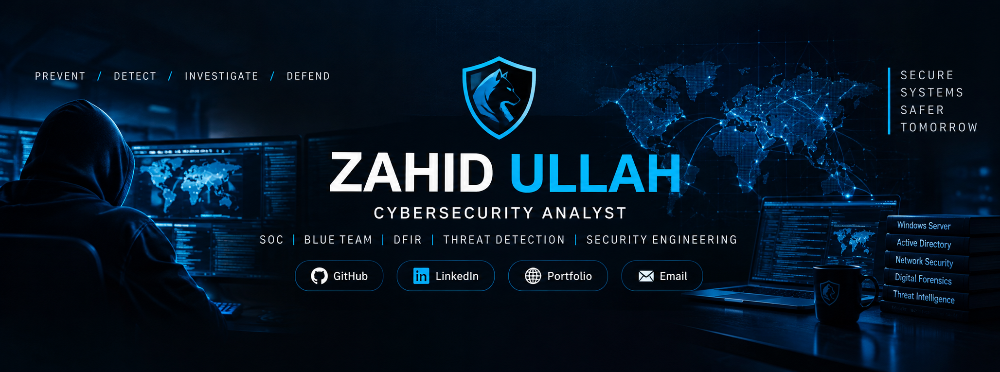

<div align="center">
<div align="center">
  
</div>
<p>
<a href="https://github.com/hckr-zahid"></a>
<a href="https://linkedin.com/in/hckr-zahid"></a>
<a href="https://hckr-zahid.github.io"></a>
<a href="mailto:hckr.badguy@gmail.com"></a>
</p>

</div>


<div align="center">


*Understand the threat. Detect the behavior. Investigate the evidence. Build the defense.*

</div>

---

## About Me

I am a **Cybersecurity Analyst** with a B.S in Computer Science and a practical focus on security operations, threat detection, malware analysis, digital forensics, incident response, and network defense.

My work combines cybersecurity investigation with hands-on security engineering. I develop defensive tools, analyze suspicious activity, explore detection methodologies, automate security workflows, and document technical findings through practical projects and isolated laboratory environments.

My flagship project, **CyberGun**, is a modular malware-detection platform combining static analysis, signature-based detection, and machine-learning-assisted behavioral classification.

I also work with SIEM technologies, network intrusion detection, forensic investigation tools, vulnerability assessment, Python automation, and enterprise Windows security infrastructure.

**Professional interests:** SOC Analyst · Threat Detection Analyst · Blue Team Security · DFIR Analyst · Security Engineer

---

## Core Specializations

| Domain | Focus Areas | Technologies |
|---|---|---|
| SOC & Blue Team | Alert triage, security monitoring, threat hunting | Wazuh, Splunk, IBM QRadar, Google Chronicle |
| Threat Detection | Detection rules, IOC analysis, behavioral indicators | YARA, Suricata, Snort, Zeek |
| Malware Analysis | Static analysis, behavioral inspection, ML-assisted classification | Python, YARA, scikit-learn, LightGBM |
| DFIR | Memory analysis, disk forensics, incident timelines | Volatility, Autopsy |
| Network Security | Traffic analysis, intrusion detection, telemetry investigation | Wireshark, Zeek, Suricata |
| Vulnerability Assessment | Service discovery, risk prioritization, system hardening | Nmap, OpenVAS, Nessus, CVSS |
| Security Automation | Log parsing, IOC extraction, investigation utilities | Python, PowerShell, Bash, Regex |
| Enterprise Security | Identity management, security policies, Windows infrastructure | Windows Server, Active Directory, DNS, VMware |
| Cloud Security | Identity and access controls, cloud security fundamentals | AWS, Google Cloud |

---

## Featured Projects

### 1. CyberGun — Modular Malware Detection & Analysis Platform

**Python · PyQt5 · LightGBM · YARA · SQLite · scikit-learn**

[View CyberGun Repository](https://github.com/hckr-zahid/CyberGun)

CyberGun is my flagship security engineering project, designed to bring multiple malware-detection and host-monitoring capabilities together within a modular application.

**Key technical areas:**

- Static malware detection and signature-based analysis.
- Machine-learning-assisted behavioral classification using benchmark datasets.
- Modular behavioral monitoring and system activity inspection.
- Sandbox simulation and USB monitoring modules.
- Asynchronous communication between detection components.
- Desktop monitoring interface with security notifications.
- Quarantine tracking and forensic audit records.

The project explores how signature-based techniques, behavioral indicators, and machine-learning models can complement one another in a defensive security workflow.

**Focus:** Malware detection, defensive tooling, security automation, and security engineering.

---

### 2. Network Intrusion Detection & Security Monitoring

**Suricata · Zeek · Kibana · Elasticsearch · Wireshark**

This project focuses on network visibility, suspicious traffic detection, and security telemetry analysis in an isolated testing environment.

**Investigation and engineering areas:**

- Detection of port scanning and suspicious network activity.
- Analysis of potential denial-of-service behavior and data-exfiltration indicators.
- Development and tuning of network detection rules.
- Collection and analysis of network telemetry.
- Visualization of security events through dashboards.
- Investigation of packet captures and network sessions.
- Reduction of unnecessary alerts through rule tuning.

**Focus:** Network defense, detection engineering, traffic analysis, and threat hunting.

---

### 3. Ransomware Incident Response & Digital Forensics

**Volatility · Autopsy · NIST SP 800-61**

This investigation project examines a simulated ransomware incident using structured incident-response and forensic-analysis techniques.

**Investigation workflow:**

1. Establish the incident scope and identify available evidence.
2. Analyze memory artifacts and suspicious process activity.
3. Examine disk artifacts, filesystem records, and relevant system traces.
4. Reconstruct the sequence of events using a forensic timeline.
5. Extract indicators of compromise and document findings.
6. Recommend containment, remediation, and recovery measures.

**Focus:** Digital forensics, evidence analysis, incident handling, and technical reporting.

---

### 4. Python Security Automation Toolkit

**Python · Regex · VirusTotal · AbuseIPDB**

This project focuses on building reusable utilities to support security investigation and SOC triage.

**Technical areas:**

- Parsing authentication and system logs.
- Extracting IP addresses, domains, and file hashes.
- Identifying suspicious indicators and processes.
- Enriching indicators using threat-intelligence APIs.
- Creating command-line utilities for repeatable investigations.
- Structuring outputs to support further analysis and reporting.

**Focus:** Security automation, threat intelligence, IOC analysis, and operational efficiency.

---

### 5. Vulnerability Assessment & System Hardening

**Nmap · OpenVAS · Nessus · Linux · CVSS**

This work explores vulnerability identification and practical defensive hardening in authorized test environments.

**Technical areas:**

- Host discovery and service enumeration.
- Vulnerability scanning and findings validation.
- Risk prioritization using CVSS.
- SSH access hardening and firewall configuration.
- Review of exposed services and unnecessary attack surface.
- Patch management and secure configuration practices.
- Documentation of findings and remediation recommendations.

**Focus:** Vulnerability management, security assessment, and defensive system administration.

---

### 6. Enterprise Active Directory & VMware Security Lab

**Windows Server 2019 · AD DS · DNS · Group Policy · VMware**

[View Active Directory Labs](https://github.com/hckr-zahid/Active-Directory-Labs)

This laboratory provides practical experience with enterprise identity infrastructure and Windows security administration.

**Documented lab areas:**

- Active Directory Domain Services deployment.
- Domain controller and DNS validation.
- Organizational unit and user management.
- Group Policy configuration and verification.
- Domain-joined Windows client administration.
- Identity and access management fundamentals.
- Virtualized network isolation and connectivity testing.
- Technical documentation and troubleshooting.

**Focus:** Enterprise infrastructure security, identity management, Windows security, and policy enforcement.

---

## Security Investigation Workflow

```text
             SECURITY TELEMETRY
                     |
                     v
           DETECTION & TRIAGE
                     |
                     v
          THREAT INVESTIGATION
                     |
                     v
       EVIDENCE & IOC COLLECTION
                     |
                     v
       IMPACT AND RISK ASSESSMENT
                     |
                     v
        CONTAINMENT & REMEDIATION
                     |
                     v
           REPORT & IMPROVE
```

My approach combines technical investigation with evidence-based analysis. The objective is to understand what happened, identify relevant indicators, determine potential impact, and recommend appropriate defensive actions.

---

## Technical Skills

### SOC, SIEM & Threat Intelligence

- Security monitoring and alert triage
- Threat hunting and IOC extraction
- SIEM investigation and event correlation
- Threat intelligence enrichment
- Detection rule development and tuning
- Wazuh, Splunk, IBM QRadar, Google Chronicle, Kibana

### Malware Analysis & Detection Engineering

- Static and behavioral analysis
- Signature-based detection
- YARA rules
- Machine-learning-assisted classification
- Sandbox-based analysis concepts
- Python security tooling

### Digital Forensics & Incident Response

- Volatile memory analysis with Volatility
- Disk and filesystem analysis with Autopsy
- Forensic timeline reconstruction
- Evidence and artifact analysis
- Incident documentation
- NIST-aligned incident-response workflows

### Network & Infrastructure Security

- Wireshark, Zeek, Suricata, Snort
- Nmap, OpenVAS, Nessus
- Firewall policies and Linux hardening
- Windows Server and Active Directory
- DNS troubleshooting and Group Policy
- VMware-based laboratory environments

### Programming & Automation

- Python, PyQt5, Pandas, scikit-learn
- Bash and PowerShell
- C++ and object-oriented programming
- SQL, SQLite, Regex, JSON
- Git and GitHub

### Cloud Security

- AWS and Google Cloud security fundamentals
- Identity and access management concepts
- Least-privilege access principles
- Security logging and audit telemetry

---

## Certifications & Education

### Education

**Bachelor of Science in Computer Science**  
University of Peshawar, Pakistan · 2025

### Selected Certifications & Training

- Certified in Cybersecurity (CC) — ISC2
- Certified Ethical Hacker (CEH) — Cisco / NAVTTC Pakistan
- Google Cybersecurity Professional Certificate
- Google Cloud Cybersecurity Certificate
- IBM Cybersecurity Analyst Professional Certificate
- IBM and ISC2 Cybersecurity Specialist
- Fortinet Network Security
- Object-Oriented Programming Specialization — University of London

Additional training and credentials are listed in my professional CV.

---

## Current Focus

- Improving malware detection and analysis capabilities in CyberGun.
- Developing practical network detection and monitoring workflows.
- Expanding incident-response and forensic investigation documentation.
- Building repeatable Python tools for security analysis.
- Conducting authorized vulnerability assessments and hardening exercises.
- Documenting enterprise security labs with reproducible steps and verification evidence.

---

## Technical Documentation Philosophy

I believe effective cybersecurity requires more than familiarity with tools. It requires understanding how systems behave, recognizing suspicious activity, validating findings, and communicating technical conclusions clearly.

My project methodology emphasizes:

- Reproducible laboratory environments.
- Evidence-based investigation.
- Clear technical explanations.
- Detection logic and verification.
- Documented findings and remediation.
- Continuous improvement through testing.

All security testing is intended for authorized systems and controlled laboratory environments.

---


<div align="center">

**SECURITY · DETECTION · INVESTIGATION · DEFENSE**

*Building practical security tools. Investigating threats. Strengthening defenses.*


<p>
<a href="https://github.com/hckr-zahid"></a>
<a href="https://linkedin.com/in/hckr-zahid"></a>
<a href="https://hckr-zahid.github.io"></a>
<a href="mailto:hckr.badguy@gmail.com"></a>
</p>

</div>

